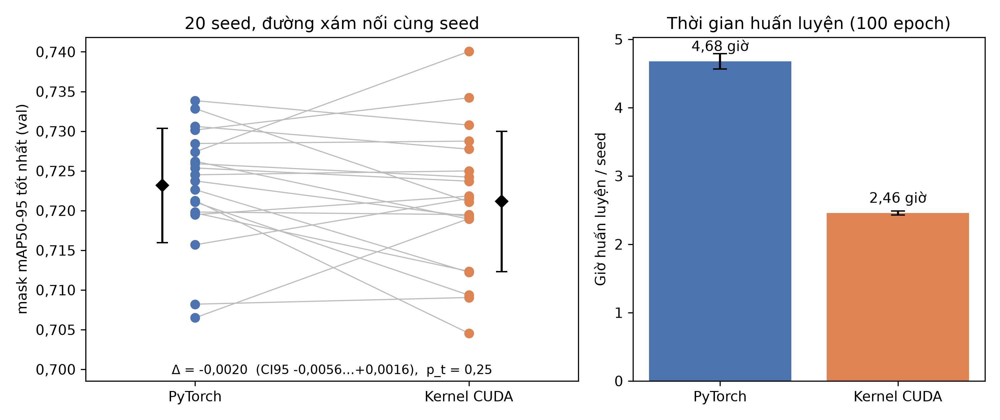

# Hướng 4, mốc 3: TSVM huấn luyện bằng kernel CUDA, 20 seed (26/11/2026)

## Phạm vi so sánh

So sánh ghép cặp theo seed giữa hai bản TSVM:

| Bản | Nguồn | Môi trường |
|---|---|---|
| TSVM PyTorch | lượt báo cáo, `Test_Mau/03_ket_qua_huan_luyen/TSVM_FP32` | Kaggle, như báo cáo |
| TSVM kernel CUDA | lượt mới của mốc 3 | Kaggle Tesla T4, `mamba_ssm` 2.3.2.post1 |

- **Siêu tham số:** giống hệt nhau (106 tham số chép từ `args.yaml`). Chỉ khác cách quét SS2D.
- **Endpoint chính:** mask mAP50-95 tốt nhất trên val 160 ảnh. Các chỉ số còn lại chỉ để thăm dò, chưa hiệu chỉnh so sánh bội.
- **Cách tính:** mọi số do script [`../scripts/phan_tich_moc3_20seed.py`](../scripts/phan_tich_moc3_20seed.py) tính từ `results.csv` gốc.
  - Số liệu từng seed: [`bang_20seed.csv`](bang_20seed.csv).
  - Thống kê: [`thong_ke.json`](thong_ke.json).
  - Dữ liệu tải từ Kaggle: `tai_ve_kaggle/` (6 gói).

## Kết quả

| Chỉ số | PyTorch (mean ± SD) | Kernel CUDA (mean ± SD) | Δ (CUDA − PT) | CI 95% của Δ | p (t ghép cặp) | p (Wilcoxon) | d_z | Số seed CUDA cao hơn |
|---|---|---|---|---|---|---|---|---|
| **mask mAP50-95 tốt nhất** (chính) | 0,7232 ± 0,0072 | 0,7212 ± 0,0088 | −0,0020 | −0,0056 … +0,0016 | 0,25 | 0,26 | −0,26 | 8/20 |
| mask mAP50 | 0,9083 ± 0,0086 | 0,9059 ± 0,0097 | −0,0024 | −0,0083 … +0,0036 | 0,41 | 0,31 | −0,19 | 7/20 |
| box mAP50-95 | 0,7273 ± 0,0134 | 0,7234 ± 0,0120 | −0,0039 | −0,0111 … +0,0033 | 0,27 | 0,19 | −0,25 | 7/20 |
| mask mAP50-95, trung bình 10 epoch cuối | 0,7100 ± 0,0113 | 0,7084 ± 0,0109 | −0,0015 | −0,0070 … +0,0039 | 0,56 | 0,48 | −0,13 | 8/20 |
| **Giờ huấn luyện / seed** | 4,68 ± 0,11 | **2,46 ± 0,03** | **−2,22** | −2,27 … −2,17 | < 10⁻²⁰ | 2·10⁻⁶ | | 20/20 nhanh hơn |

- **Độ ổn định:** kiểm định Levene theo trung vị cho mAP chính ra p = 0,45 (chỉ để thăm dò). SD của hai bản gần nhau: 0,0072 và 0,0088.
- **Epoch tốt nhất (trung bình):** PyTorch 90,2, CUDA 87,4.

## Nhận xét

1. **Thời gian huấn luyện giảm 47%**, từ 4,68 xuống 2,46 giờ mỗi seed. Mức giảm này nhất quán ở cả 20 seed. Thời gian mới gần bằng baseline YOLO26s-seg (2,32 giờ trong ablation), nghĩa là phần chi phí thêm do SS2D gần như không còn.
2. **Chưa thấy khác biệt về độ chính xác.**
   - Δ mAP50-95 là −0,0020, p = 0,25, và CI 95% có chứa 0.
   - Khoảng tin cậy nằm trong ±0,0074 (1 SD của 20 seed). Theo quy tắc đặt ra từ đầu, hai bản được coi là **tương đương trong phạm vi dao động giữa các seed**.
   - Trung bình bản CUDA thấp hơn rất ít, nhưng chưa đủ bằng chứng để nói bản này kém hơn.
3. **Không lặp lại được từng bit.** Cùng một seed, hai bản cho kết quả khác nhau ngay từ epoch 1. Lý do:
   - kernel cộng gradient bằng atomicAdd;
   - thứ tự cộng số thực khác với bản PyTorch.

   Vì vậy chỉ nên so theo phân phối 20 seed, không so từng seed. Ví dụ seed 15 (best.pt dùng cho web) cho −0,0073, nhưng seed 1 lại cho +0,0126.
4. **Kết quả thực tế:**
   - Có thể dùng kernel để huấn luyện TSVM nhanh gấp khoảng 1,9 lần mà không thấy thay đổi đáng kể về mAP.
   - Từ mốc 2 (T4): forward batch 1 giảm từ 37,5 ms xuống 19,9 ms, bộ nhớ một bước huấn luyện giảm từ 10,9 GB xuống 5,6 GB.

## Đánh giá theo pixel trên tập test (giao thức Bảng 4.8), 26/11

**Tập test:** 160 ảnh val của BG20, gồm 120 ảnh test chính thức của Kvasir-SEG và 40 ảnh nền. BG20 không có tập test riêng, nên đây đúng là tập báo cáo dùng cho Bảng 4.8.

**Cách đánh giá:**
- Script [`../scripts/danh_gia_pixel_cuda_20seed.py`](../scripts/danh_gia_pixel_cuda_20seed.py) gọi lại `danh_gia_pixel.py` của báo cáo, không sửa script gốc.
- Thông số: imgsz 640, conf 0,25, iou 0,7, gộp tất cả mặt nạ của một ảnh.
- Suy luận trên laptop RTX 5050 bằng nhánh PyTorch, mất 1,4 phút cho 20 seed.
- Kết quả nằm ở `pixel_test/`. Các tệp `*_thu.csv` là lần chạy thử với seed 0.
- So sánh ghép cặp: [`../scripts/so_sanh_pixel_cuda_pt.py`](../scripts/so_sanh_pixel_cuda_pt.py), kết quả ở `pixel_test/13_so_sanh_ghep_cap.csv`.

| Chỉ số (120 ảnh polyp) | YOLO26s-seg (báo cáo) | TSVM PyTorch (báo cáo) | TSVM kernel CUDA | Δ CUDA − PT [CI 95%], p_t | Δ CUDA − YOLO, p_t |
|---|---|---|---|---|---|
| Dice | 0,8486 ± 0,0171 | 0,8540 ± 0,0129 | 0,8467 ± 0,0150 | −0,0073 [−0,0165; +0,0019], p = 0,11 | −0,0019, p = 0,67 |
| IoU | 0,7927 | 0,7998 | 0,7925 | −0,0073 [−0,0162; +0,0015], p = 0,10 | −0,0003, p = 0,95 |
| Precision | 0,8585 | 0,8632 | 0,8548 | −0,0084, p = 0,11 | −0,0038, p = 0,42 |
| Recall | 0,8703 | 0,8730 ± 0,0112 | 0,8653 ± 0,0182 | −0,0078, p = 0,09 | −0,0051, p = 0,33 |
| Ảnh nền bị báo nhầm (40 ảnh) | 1,25% | 1,50% | 1,88% | +0,38 điểm %, p = 0,56 | +0,62 điểm %, p = 0,29 |

**Nhận xét:**
- Với Dice theo pixel, bản CUDA thấp hơn bản PyTorch 0,0073, và chỉ cao hơn ở 7/20 seed. Tuy vậy p = 0,11 và CI 95% vẫn chứa 0, nên mới chỉ là **xu hướng thấp hơn nhẹ**, chưa đủ bằng chứng.
- Mức chênh này lớn hơn mức chênh của mAP (−0,0020). Hai chỉ số không mâu thuẫn nhau:
  - Dice tính ở ngưỡng conf 0,25 cố định;
  - mAP tính trên mọi ngưỡng.
- Bản CUDA gần như ngang YOLO26s-seg gốc (Δ Dice −0,0019, p = 0,67). Nghĩa là phần Dice tăng thêm mà TSVM PyTorch có trong báo cáo (+0,0054 so với YOLO, vốn cũng chưa có ý nghĩa thống kê) **không xuất hiện lại** ở lượt huấn luyện bằng kernel.
- Recall của bản CUDA dao động lớn hơn (SD 0,018 so với 0,011, Levene p = 0,015, chỉ để thăm dò).
- Số ảnh nền bị báo nhầm gần như như nhau: trung bình 0,75 ảnh trên 40 ảnh mỗi seed.

**Diễn giải:** kernel CUDA giữ độ chính xác ở mức không phân biệt được về thống kê so với cả hai mô hình của báo cáo. Tuy nhiên, ưu thế nhỏ của TSVM so với YOLO trong báo cáo không vững trước thay đổi số học khi huấn luyện. Điều này khớp với kết luận "xu hướng, chưa có ý nghĩa" đã viết trong báo cáo.

## Đánh giá trên dữ liệu khác nguồn và 800 ảnh manh tràng (giao thức Mục 4.7), 26/11

**Dữ liệu và giao thức:**
- Script [`../scripts/danh_gia_ngoai_cuda_20seed.py`](../scripts/danh_gia_ngoai_cuda_20seed.py) gọi lại `run()` của `08_du_lieu_thuc_te/scripts`, không sửa mã gốc.
- Bốn bộ có polyp: CVC-ClinicDB 612 ảnh, CVC-ColonDB 380, ETIS 196, PolypGen C1–C6 1.537 (trong đó 125 ảnh không có polyp).
- Đo báo nhầm trên 800 ảnh manh tràng.
- Chạy trên GPU laptop: 22,5 phút cho bốn bộ có polyp, 5,5 phút cho ảnh manh tràng.

**Cách so sánh:**
- Script [`../scripts/so_sanh_ngoai_cuda_pt.py`](../scripts/so_sanh_ngoai_cuda_pt.py) tính chỉ số từng seed bằng đúng công thức của báo cáo.
- So ghép cặp với các bảng `20seed/01_ngoai_tung_seed.csv` và `nen_cecum/06_nen_cecum_tung_seed.csv` của báo cáo.
- Kết quả nằm trong `du_lieu_ngoai/01–03_*.csv`.

**Dice trung bình theo ảnh, 20 seed:**

| Bộ dữ liệu | YOLO26s-seg (báo cáo) | TSVM PyTorch (báo cáo) | TSVM kernel CUDA | CUDA − PT, p_t | CUDA − YOLO, p_t |
|---|---|---|---|---|---|
| CVC-ClinicDB | 0,7860 | 0,7702 | 0,7766 ± 0,0122 | +0,0063, p = 0,22 | −0,0094, p = 0,020 |
| CVC-ColonDB | 0,6308 | 0,6012 | 0,6098 ± 0,0245 | +0,0086, p = 0,41 | −0,0210, p = 0,006 |
| ETIS | 0,5347 | 0,5293 | 0,5301 ± 0,0409 | +0,0007, p = 0,96 | −0,0046, p = 0,74 |
| PolypGen (gộp 6 trung tâm) | 0,7188 | 0,7153 | 0,7176 ± 0,0132 | +0,0023, p = 0,62 | −0,0011, p = 0,83 |
| PolypGen từng trung tâm C1–C6 | | | | Δ từ −0,0012 đến +0,0105, mọi p ≥ 0,15 | |

**Tỉ lệ ảnh không polyp bị báo nhầm:**

| Tập ảnh | TSVM PyTorch | TSVM CUDA | p |
|---|---|---|---|
| 800 ảnh manh tràng | 1,36% | 1,43% | 0,71 |
| 125 ảnh PolypGen không polyp | 10,8% | 11,1% | 0,74 |

**Nhận xét** (đây là so sánh thăm dò, chưa hiệu chỉnh so sánh bội):
- **So với TSVM PyTorch:** không bộ dữ liệu nào cho thấy khác biệt. Δ Dice nằm trong khoảng −0,001 đến +0,011, mọi p ≥ 0,15. Bản CUDA cao hơn ở 7–13 trên 20 seed. Tỉ lệ báo nhầm và tỉ lệ bỏ sót toàn ảnh (`no_pred_rate`) cũng gần như bằng nhau.
- **So với YOLO26s-seg gốc:** trên CVC-ClinicDB và CVC-ColonDB, bản CUDA thấp hơn rõ (p = 0,02 và 0,006). Đây là **cùng xu hướng đã thấy ở TSVM PyTorch trong báo cáo**: TSVM kém YOLO trên hai bộ CVC. Trên ETIS và PolypGen, hai bên ngang nhau.
- Như vậy, trên dữ liệu ngoài, việc đổi sang kernel CUDA không làm thay đổi khả năng tổng quát hóa của TSVM.
- Riêng trên tập test, Dice có xu hướng thấp hơn nhẹ (−0,007, p = 0,11). Hiện tượng này không lặp lại trên dữ liệu ngoài, nên nhiều khả năng chỉ là dao động giữa các seed.

## Hạn chế

- Cả hai bản chỉ được đánh giá trên tập val 160 ảnh, giống báo cáo. Chưa đánh giá trên tập test hay dữ liệu ngoài.
- Thời gian huấn luyện của bản PyTorch lấy từ cột `time` trong `results.csv`. Bản này chạy trên Kaggle, mình không chắc từng lượt dùng cùng loại GPU T4. Bản CUDA đo bằng `gio.txt` trên T4.
- Kernel chỉ chạy được trên Linux có `mamba_ssm`. Laptop Windows và web PolypVision vẫn dùng nhánh PyTorch. Trọng số `best.pt` dùng chung được giữa hai bản.
